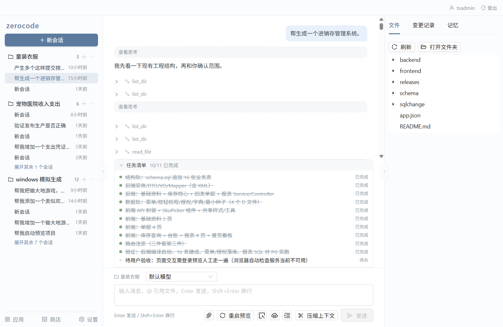
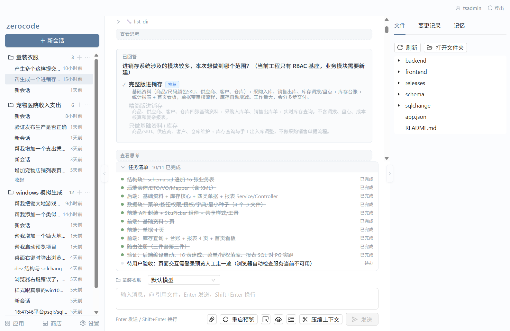
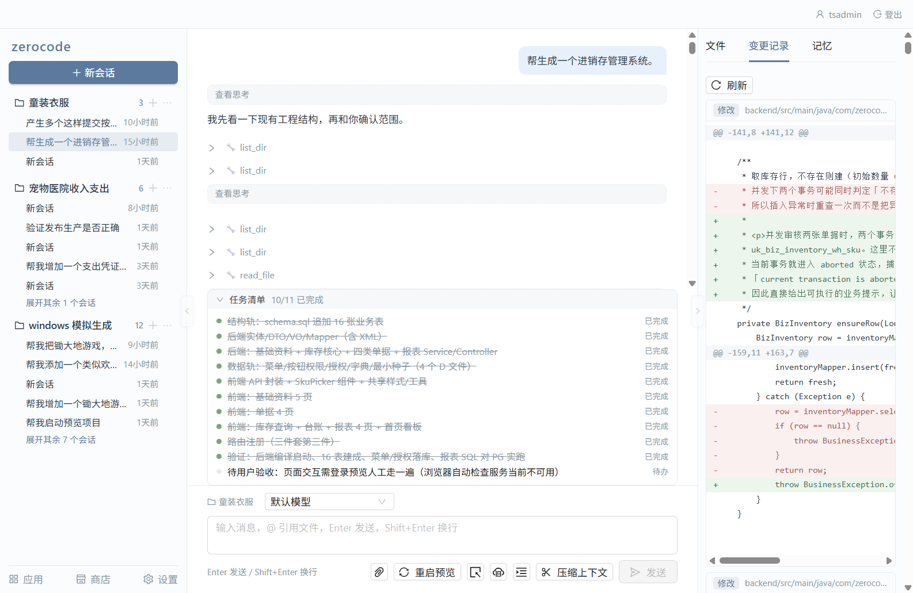
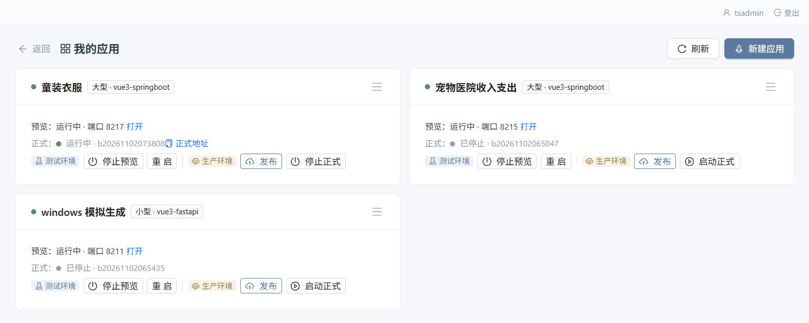
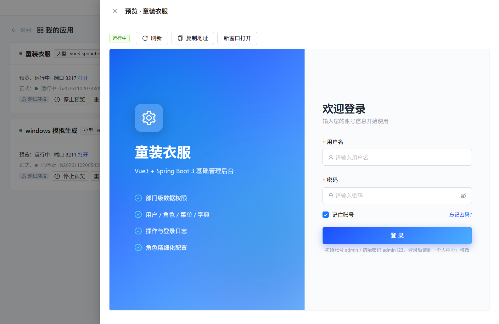
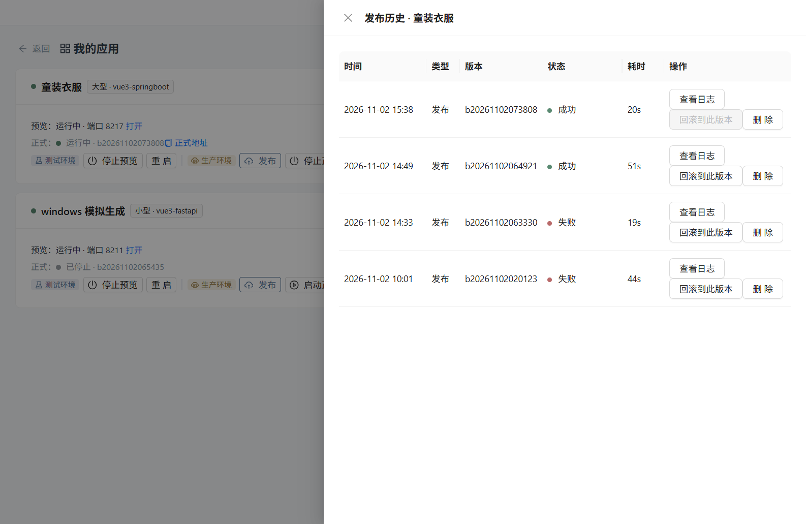
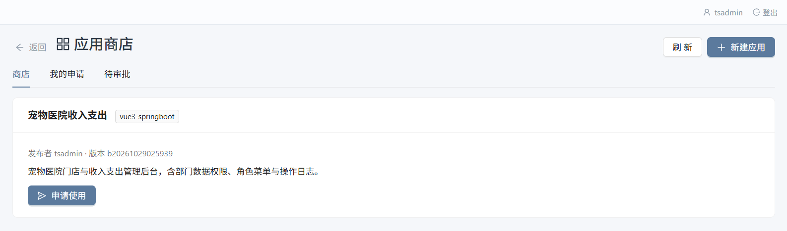

<div align="center">

# ZeroCode

### 像聊天一样，长出你的业务系统
**Build software by simply talking about it.**

`零开发经验可用` · `代码数据本机自持` · `一句话到一键上线`

**在线体验 → <http://159.75.185.70:8100/>** · 账号 `tsadmin` / 口令 `tsadmin`

</div>

---

## ZeroCode 是什么

ZeroCode 是一台跑在**你自己机器上**的 AI 应用工厂。

你不需要会写代码——像平时聊天一样，把想要的软件讲清楚（一个台账、一张登记表、一套查询页面），AI 就当场把前后端和数据库写出来，让你在浏览器里**立刻预览、边用边改**。满意了点一下「发布」，它就变成一个同事能直接访问的正式应用。

它不是一次性的代码生成器，而是替你**从生成、预览、上线到升级全程养着**的完整交付平台。

---

## 为什么有了成熟的 AI Agent，还需要 ZeroCode？

成熟的 AI Agent 很会「把代码写出来」，但代码写完之后——环境、数据库、预览、发布、回退、给团队分发独立实例——仍然要你自己扛。ZeroCode 补的正是这一段：Agent 留在流水线里干活，你只管聊天确认、点「发布」，拿到一个同事能打开、坏了能回滚的正式应用。它服务的不是已经会用终端和部署的开发者，而是「有想法、但不写代码」的人，以及要把一份应用分发给整个团队的场景；代码和数据始终留在你自己机器上，产物是标准工程，随时可以带走。

---

## 在线体验

不用装环境，先逛一遍再决定：

| 入口 | 地址 |
| --- | --- |
| 演示站 | <http://159.75.185.70:8100/> |
| 账号 / 口令 | `tsadmin` / `tsadmin` |

进去后建议这么逛：

1. 左侧「应用」→ 任意一张应用卡片右上角的 ☰ → **预览**，看一个由一句话生成、正在运行的业务后台（下文「说完即用」一节的配图就是它）。
2. 回到聊天页，点开任意一条历史会话，看 AI 怎么拆任务、逐文件写代码，右侧「变更记录」里每一条 diff。
3. 左侧「商店」看上架与申请使用；「设置」里可以换你自己的模型凭据。

> 演示站是共用的，请不要删除别人已有的应用与会话，数据也可能随时被重置。

---

## 它能替你做什么

### 1. 对话式开发 —— 说需求，看它写
选一个应用作为工作区，直接把需求说出来。AI 会分解任务、逐文件写代码，改动以差异（diff）形式透明呈现，**写哪个文件、改成什么样，你确认后才落盘**。可以随时打断补充（执行中插话），也能 `@` 引用工作区里的文件给它当上下文；手头的原型图、报错截图直接粘进输入框，视觉模型看着图改页面。



动手改文件之前，它会先把歧义摊成一道一道选择题（带推荐项和说明）让你点选——范围、取舍、命名先对齐，再开工。



每一处改动都留痕：右侧「变更记录」按文件摊开 diff，「文件」页能直接浏览工程树，谁改了什么、改了多少行，一目了然。



### 2. 应用工坊 —— 每个应用独立成套
「新建应用」三步向导：起名字 → 选规模 → 选技术栈。每个应用都有独立的代码目录、独立的开发数据库、自动分配的端口，互不干扰。一张卡片管两套环境——**测试环境**（预览、重启、看日志）与**生产环境**（发布、启停、正式地址），外加发布历史、资源监控、DB 操作、重建 dev 等一整套运维动作。



### 3. 说完即用 —— 本机预览，一键上线
应用点「启动预览」，右侧抽屉里直接内嵌运行中的应用，边用边改；改完代码或加了数据变更，点「重启」即时生效。出问题时在同一处抽屉里看实时日志，不必回终端翻。



预览满意后点「发布」，交给一条自动化流水线：发布前检查 → 构建镜像 → 供给数据库 → 数据迁移 → 启动正式栈 → 联合体检 → 记账。跑完直接给你一个可访问地址，局域网内同事即可打开。构建或体检失败会**自动回退上一版本**，旧版本全程不中断；「发布历史」里还能一键回滚。配好中央网关后，正式应用还可走 `https://{应用名}.域名` 直达。



### 4. 应用商店 —— 一次开发，全团队复用
把发布好的应用一键上架。同事在商店里申请、平台管理员（创始人）审批后，平台自动为他建一份**完全独立的实例**（独立代码 + 独立数据库 + 独立地址），数据各自一份、互不可见。升级时平台先在真数据的克隆库上预演一遍再动正式库，稳妥可回退。



### 能力速查

| 你想做的事 | ZeroCode 怎么帮你 |
| --- | --- |
| 换不同的 AI 模型 | 支持 OpenAI 兼容的多套凭据，按会话随时切换；模型是否支持看图可在设置里声明 |
| 带图提需求 | 输入框支持粘贴 / 拖拽 / 选择图片，视觉模型直接照着图改 |
| 会话太长 | 一键压缩上下文，长任务不爆窗口 |
| 让它记住你的项目 | 工作区级记忆：把约定与踩过的坑沉淀下来，下个会话继续用 |
| 改数据结构 | 数据变更写成 `sqlchange` 脚本，启动预览时按序自动执行，只补跑没跑过的 |
| 排查启动失败 | 页面内实时日志抽屉，先拉历史再订阅当前 |
| 上线后维护 | 发布失败自动回退、保留多版本、一键回滚、资源监控 |
| 团队复用 | 应用商店上架 + 申请审批 + 独立实例供给与升级 |

---

## 会带来什么改变

**对你意味着：**

- **非程序员也有了一条软件交付通道** —— 业务想法不必排队等专业开发排期，自己就能长出能用的系统。
- **从原型到上线，周期从「周」压缩到「小时」** —— 生成、预览、发布在同一条链路上一次跑通。
- **代码和数据完全在自己手里** —— 整套平台跑在本地，产物是标准 Vue3 + 后端工程，不锁定、可带走。

**你需要知道的：**

- **运行环境**：支持 Windows / macOS / Linux，需装有 Docker；平台与生成的应用都跑在容器里。
- **访问方式**：默认本机预览，发布后支持局域网与域名远端访问，同事可直接打开。
- **最适合**：台账、登记、查询、审批、统计这类中小型业务应用。
- **请现实期待**：它是把想法快速变成可用软件的高效工具，不是「零基础变资深工程师」的魔法；超大型核心交易系统仍需专业团队开发。

---

## 怎么用 · 四步从想法到上线

1. **建应用** —— 侧栏「应用」→「新建应用」，三步向导起好名字、选好规模与技术栈。
2. **提需求** —— 在聊天页选中这个应用，直接说你想加什么，例如「加一个来料登记页面，带日期和数量字段」。AI 边写边让你确认。
3. **看预览** —— 应用卡片点「启动预览」，在右侧抽屉里直接操作页面；改了代码或加了数据变更，点「重启」即时生效。
4. **发出去** —— 点「发布」跑完流水线拿到访问地址分享给同事；或「发布到商店」，让他们申请、平台管理员审批后各得一份独立实例。

> 想照着界面一步步走——每个按钮在哪、点了会怎样、出问题看哪一栏——看 [用户操作手册](docs/user-manual.md)。

---

## 技术栈

| 层次 | 选型 |
| --- | --- |
| 生成的应用 · 小型 | Vue 3 + FastAPI + PostgreSQL |
| 生成的应用 · 大型 | Vue 3 + Spring Boot 3（含 RBAC 权限体系、JWT 认证、Redis 登录态） |
| 平台后端 | Python 3.11+、FastAPI、SQLAlchemy、asyncpg、Pydantic 2 |
| 平台前端 | Vue 3.5、Ant Design Vue、Pinia、Vue Router、Vite |
| 运行与交付 | Docker Compose（应用 dev/prod 容器）+ 中央 OpenResty 网关（通配域名 HTTPS） |
| AI 接入 | OpenAI 兼容多模型凭据，按会话切换 |

> 生成的是**标准工程代码**，不是黑盒——可以直接用熟悉的编辑器打开、纳入你自己的版本管理。

---

## 部署：拉取源码之后

先把代码拉下来（主仓在 Gitee，GitHub 那份是镜像）：

```bash
git clone https://gitee.com/leerys/zerocode.git
cd zerocode
```

两条路线，按你要什么选：

| 你想要的 | 走 | 需要的工具 |
| --- | --- | --- |
| 本机马上跑起来自己用，或改平台代码 | **路线 A** 源码直跑 | Docker、Node 20.19+ / 22.12+、Python 3.11+ |
| 装到一台服务器或同事的机器上正式交付 | **路线 B** 出包 → 一键部署 | 打包机：Node + Python（**不需要 Docker**）；目标机：Linux，或带 WSL2 的 Windows——Docker 缺了脚本自己装 |

### 路线 A · 源码本机跑通

**1）起平台数据库**（pgvector 镜像，宿主端口 5433；`-v` 必带，否则数据落在匿名卷里，下次 `docker rm` 就没了）：

```powershell
docker run -d --name zerocode-pg16 `
  -v zerocode-pgdata-v2:/var/lib/postgresql/data `
  -e POSTGRES_USER=zerocode -e POSTGRES_PASSWORD=zerocode123 -e POSTGRES_DB=zerocode `
  -p 5433:5432 pgvector/pgvector:pg16
```

容器名与端口是约定值，不是随便起的：已发布的应用靠 DNS 别名 `zerocode-pg16:5432` 连库。

**2）一键拉起开发环境**（Windows，仓库根）：

```powershell
.\dev.bat
```

它依次尝试启动 PG 容器 → 建 `.venv` 并装后端依赖 → `npm install --prefix frontend` → 新窗口起后端 `:8100`、当前窗口起 Vite `:8082`，并自动打开浏览器。改前后端代码即时生效。故意不带 `--reload`：部署套件会往 `apps/` 写生成文件，热重载会被自己触发到刷屏。

**3）macOS / Linux 的等价手工四条**（仓库里的 `.bat` 入口只在 Windows 可用）：

```bash
python3 -m venv .venv && .venv/bin/pip install -r requirements.txt
npm install --prefix frontend
.venv/bin/python -m uvicorn app.main:app --host 127.0.0.1 --port 8100 &   # 后端
npm run dev --prefix frontend                                             # 前端 http://127.0.0.1:8082
```

**4）只对外开一个端口**（不要 Vite，构建产物由后端直接托管）：

```powershell
.\build.bat    # 进 frontend 执行 npm run build，产物 frontend/dist
.\start.bat    # uvicorn app.main:app --host 127.0.0.1 --port 8100
```

**5）配模型**：打开 <http://127.0.0.1:8082>（或 `:8100`）→ 注册账号 → 「设置 → 模型库」填一套 OpenAI 兼容凭据（Base URL / 模型名 / API Key）并设为默认。

> **没配模型就先聊天，会一直报连接错误**——回落链取不到凭据时它会直接去连官方端点然后超时，这不是网络问题。
>
> 端口约定：平台后端 `8100`、前端 dev `8082`、平台库宿主 `5433`；每个应用的 dev / prod 端口由平台从 `8210-8399` 自动分配。

### 路线 B · 出包，一键部署到别的机器

**1）打包**（在开发机跑仓库根的 `build-output.bat`，双击或命令行都行）：

```powershell
.\build-output.bat                        # 只出平台，不带预置应用
.\build-output.bat --slugs test1,sqlc002  # 连这两个应用一起带过去
.\build-output.bat --gateway-domain demo.example.com    # 通配域名网关
.\build-output.bat --apt-mirror mirrors.aliyun.com --pypi-mirror https://mirrors.aliyun.com/pypi/simple --npm-registry https://registry.npmmirror.com
```

它先构建前端，再把 `build-output/` 整目录组装出来：`docker-compose.yml`、后端与浏览器 sidecar 的 Dockerfile、由 `changelog/` 全量合成的 `init.sql`、四份部署脚本（`deploy.sh` / `deploy_lib.sh` / `deploy.ps1` / `deploy.bat`）和一份 `README-deploy.md`。所有闸门（重放安全、幂等、端口冲突、凭据扫描）全过才换包；任何一道不过，上一次的包原样不动。

**2）传到目标机**：整个 `build-output/` 目录搬过去（`scp`、共享盘、先压成 zip 再解都行）。

**3）跑部署**——Linux 目标机一条命令：

```bash
cd build-output
bash deploy.sh
```

Windows 目标机：双击包根的 `deploy.bat`，或在 PowerShell 里 `powershell -ExecutionPolicy Bypass -File .\deploy.ps1`。它只负责把 WSL2 与发行版弄成可用状态、把包推进发行版，然后在发行版里跑**同一份** `deploy.sh`——部署判定一条都不留在 Windows 侧。

脚本全程问答式、没有命令行参数，按顺序收：这次是新增还是升级、部署根（默认 `/opt/zerocode`）、库账号与口令、控制台端口、预览展示地址、三个镜像源、要不要起中央网关。缺 Docker 会装（可选配 registry 加速），端口被占会点名占用者是容器还是宿主进程再问你怎么腾，升级时只镜像 `backend/` `browser/` `frontend/` 三棵、现场产物一个不碰。答过的非敏感项落盘在部署根的 `.deploy-answers`，下次一路回车复用。

**4）验收**：跑完打印控制台地址 `http://<服务器IP>:8100`、预览地址基座与端口段。**第一个注册的账号自动成为创始人**并接管包里的预置应用；随后到「设置 → 模型库」换成你自己的模型凭据。

> 九步问答的细节、中央网关 HTTPS 与证书、预置应用「先预览再发布」的固定顺序、升级护栏（哪八项现场产物绝不碰）与整张排障表，都在包内 `build-output/README-deploy.md`。
>
> 境内机器直连 Docker Hub / PyPI / npm 拉不动时：出包时给 `--apt-mirror` / `--pypi-mirror` / `--npm-registry`，或在部署问答里现场改——同一份源会同时管住平台自己和它起出来的每一个应用栈。域名还没备案时把 `ZEROCODE_SSL_ENABLE` 答成 `false`，应用地址会退回 `http://<IP>:<端口>` 直连，网关不用拆。

不想先装环境？直接上[演示站](http://159.75.185.70:8100/)逛一圈（`tsadmin` / `tsadmin`）。

> 接口一览、环境变量、测试与分支约定等施工细节，见 [开发者指南](docs/developer-guide.md)。

---

## 项目结构一览

```
app/         平台后端（FastAPI：agent 循环 / api 路由 / deploy 部署套件 / store 应用商店）
frontend/    平台前端（Vue 3 单页：聊天 / 应用 / 商店 / 设置）
gateway/     中央 OpenResty 网关（通配域名 HTTPS + 动态路由）
apps/        AI 生成的应用工作区（本机生成，不入库）
changelog/   平台自身数据库迁移脚本（启动时自动执行）
tests/       后端测试，与 app/ 分层对应
```

## 文档

| 你要的是 | 去哪儿看 |
| --- | --- |
| 界面怎么操作、每个按钮点了会怎样 | [用户操作手册](docs/user-manual.md) |
| 部署九步问答、网关 HTTPS、升级护栏、排障表 | 出包后的 `build-output/README-deploy.md` |
| 项目结构、接口一览、环境变量、测试与分支约定 | [开发者指南](docs/developer-guide.md) |
| 术语定义与架构决策的来龙去脉 | [CONTEXT.md](CONTEXT.md) 与 [docs/adr/](docs/adr/) |

---

## 仓库与镜像

| 位置 | 地址 | 角色 |
| --- | --- | --- |
| Gitee | <https://gitee.com/leerys/zerocode.git> | **主仓**，日常提交、分支与 Issue 都在这里 |
| GitHub | <https://github.com/leerysink/zerocode> | 完整历史镜像 |

两边分支一一对应，只有一处命名差异：主仓的默认分支 `master` 对应 GitHub 的 `main`（GitHub 建仓时的默认分支名习惯），`feature/*` 分支同名。

GitHub 侧请只当作镜像读，**不要直接在 GitHub 上提交**——一旦它多出主仓没有的提交，主仓的 `master` 就不再能快进推上去，得先手工把那段提交回收进主仓才能继续同步。日常同步用显式 refspec：

```bash
git remote add github git@github.com:leerysink/zerocode.git   # 只需一次
git push github master:refs/heads/main                        # 每次主仓更新后
```

镜像只反映**已提交**的内容，本机未提交的改动不会跟过去。

---

<div align="center">

**ZeroCode —— 让每个有想法的人，都能把软件做出来。**

在线体验 <http://159.75.185.70:8100/>（`tsadmin` / `tsadmin`） · 主仓 <https://gitee.com/leerys/zerocode.git> · GitHub 镜像 <https://github.com/leerysink/zerocode>

</div>
