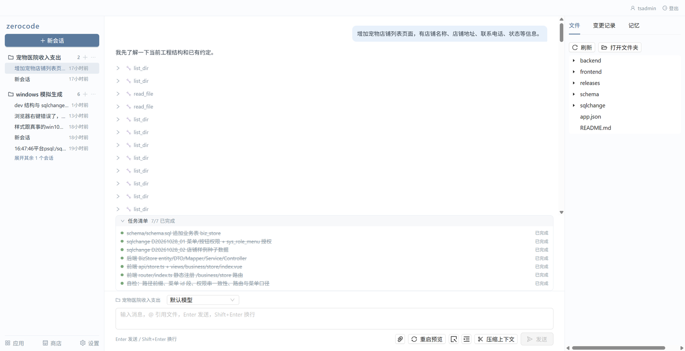
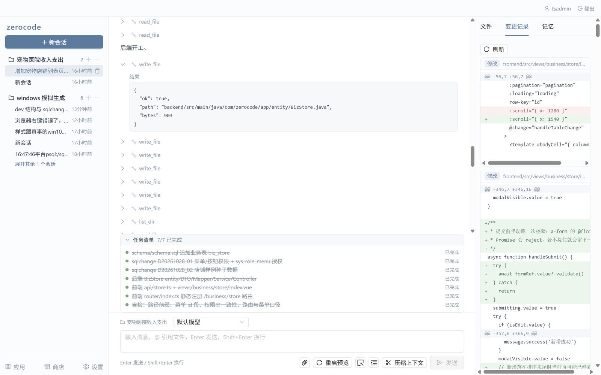
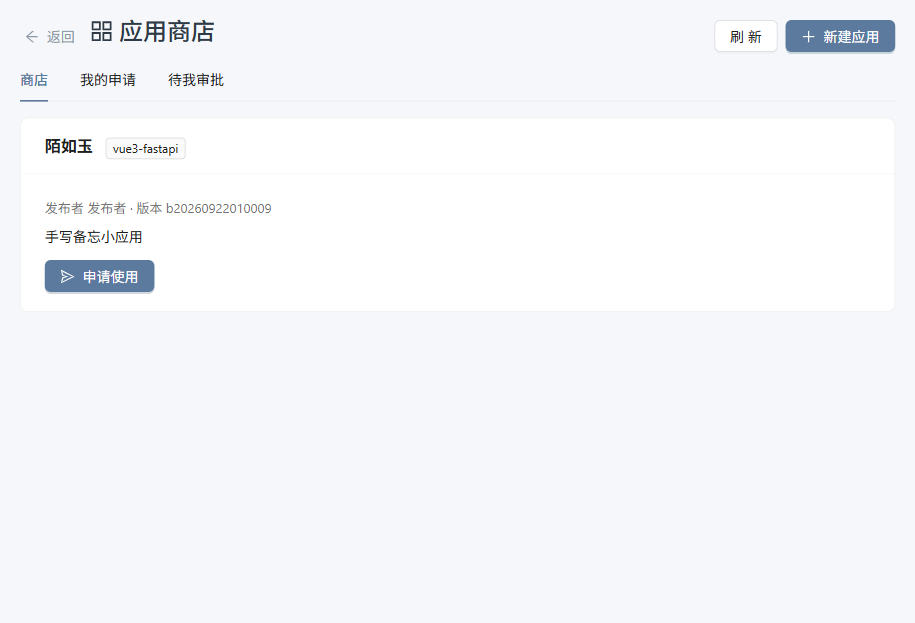
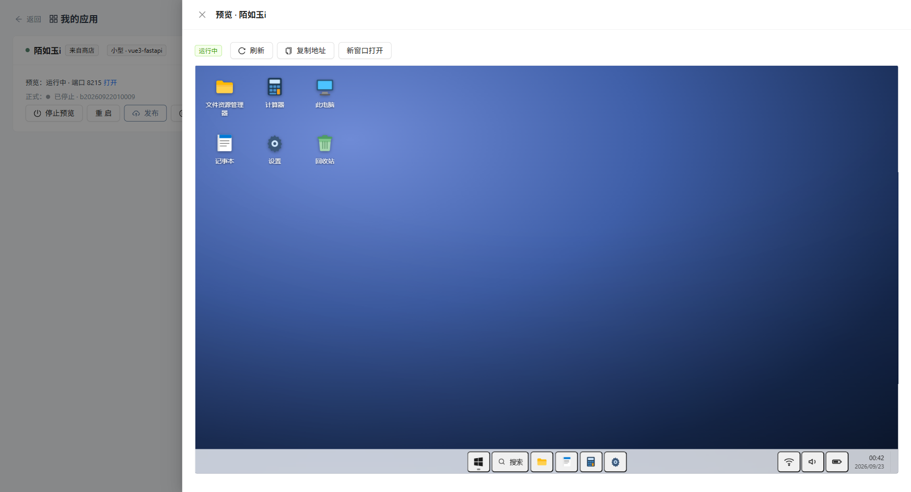
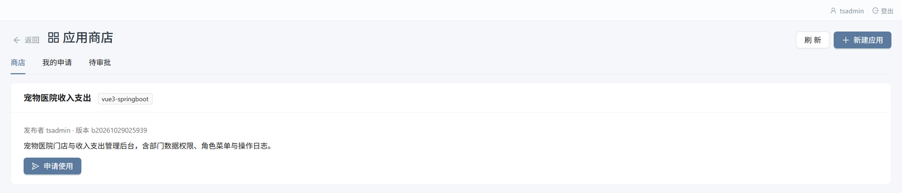

<div align="center">

# ZeroCode

### 像聊天一样，长出你的业务系统
**Build software by simply talking about it.**

`零开发经验可用` · `代码数据本机自持` · `一句话到一键上线`

**在线体验 → <http://159.75.185.70:8100/>** · 账号 `tsadmin` / 口令 `tsadmin`

</div>

---

## ZeroCode 是什么

ZeroCode 是一台跑在**你自己机器上**的 AI 应用工厂。

你不需要会写代码——像平时聊天一样，把想要的软件讲清楚（一个台账、一张登记表、一套查询页面），AI 就当场把前后端和数据库写出来，让你在浏览器里**立刻预览、边用边改**。满意了点一下「发布」，它就变成一个同事能直接访问的正式应用。

它不是一次性的代码生成器，而是替你**从生成、预览、上线到升级全程养着**的完整交付平台。

---

## 为什么有了成熟的 AI Agent，还需要 ZeroCode？

成熟的 AI Agent 很会「把代码写出来」，但代码写完之后——环境、数据库、预览、发布、回退、给团队分发独立实例——仍然要你自己扛。ZeroCode 补的正是这一段：Agent 留在流水线里干活，你只管聊天确认、点「发布」，拿到一个同事能打开、坏了能回滚的正式应用。它服务的不是已经会用终端和部署的开发者，而是「有想法、但不写代码」的人，以及要把一份应用分发给整个团队的场景；代码和数据始终留在你自己机器上，产物是标准工程，随时可以带走。

---

## 在线体验

不用装环境，先逛一遍再决定：

| 入口 | 地址 |
| --- | --- |
| 演示站 | <http://159.75.185.70:8100/> |
| 账号 / 口令 | `tsadmin` / `tsadmin` |

进去后建议这么逛：

1. 左侧「应用」→ 任意一张应用卡片右上角的 ☰ → **预览**，看一个由一句话生成、正在运行的门店管理后台（下文「说完即用」一节的配图就是它）。
2. 回到聊天页，点开任意一条历史会话，看 AI 怎么拆任务、逐文件写代码，右侧「变更记录」里每一条 diff。
3. 左侧「商店」看上架与申请使用；「设置」里可以换你自己的模型凭据。

> 演示站是共用的，请不要删除别人已有的应用与会话，数据也可能随时被重置。

---

## 它能替你做什么

### 1. 对话式开发 —— 说需求，看它写
选一个应用作为工作区，直接把需求说出来。AI 会分解任务、逐文件写代码，改动以差异（diff）形式透明呈现，**写哪个文件、改成什么样，你确认后才落盘**。可以随时打断补充（执行中插话），也能 `@` 引用工作区里的文件给它当上下文；手头的原型图、报错截图直接粘进输入框，视觉模型看着图改页面。



每一处改动都留痕：右侧「变更记录」按文件摊开 diff，「文件」页能直接浏览工程树，谁改了什么、改了多少行，一目了然。



### 2. 应用工坊 —— 每个应用独立成套
「新建应用」三步向导：起名字 → 选规模 → 选技术栈。每个应用都有独立的代码目录、独立的开发数据库、自动分配的端口，互不干扰。一张卡片管两套环境——**测试环境**（预览、重启、看日志）与**生产环境**（发布、启停、正式地址），外加发布历史、资源监控、DB 操作、重建 dev 等一整套运维动作。



### 3. 说完即用 —— 本机预览，一键上线
应用点「启动预览」，右侧抽屉里直接内嵌运行中的应用，边用边改；改完代码或加了数据变更，点「重启」即时生效。出问题时在同一处抽屉里看实时日志，不必回终端翻。



预览满意后点「发布」，交给一条自动化流水线：发布前检查 → 构建镜像 → 供给数据库 → 数据迁移 → 启动正式栈 → 联合体检 → 记账。跑完直接给你一个可访问地址，局域网内同事即可打开。构建或体检失败会**自动回退上一版本**，旧版本全程不中断；「发布历史」里还能一键回滚。配好中央网关后，正式应用还可走 `https://{应用名}.域名` 直达。

### 4. 应用商店 —— 一次开发，全团队复用
把发布好的应用一键上架。同事在商店里申请、平台管理员（创始人）审批后，平台自动为他建一份**完全独立的实例**（独立代码 + 独立数据库 + 独立地址），数据各自一份、互不可见。升级时平台先在真数据的克隆库上预演一遍再动正式库，稳妥可回退。



### 能力速查

| 你想做的事 | ZeroCode 怎么帮你 |
| --- | --- |
| 换不同的 AI 模型 | 支持 OpenAI 兼容的多套凭据，按会话随时切换；模型是否支持看图可在设置里声明 |
| 带图提需求 | 输入框支持粘贴 / 拖拽 / 选择图片，视觉模型直接照着图改 |
| 会话太长 | 一键压缩上下文，长任务不爆窗口 |
| 让它记住你的项目 | 工作区级记忆：把约定与踩过的坑沉淀下来，下个会话继续用 |
| 改数据结构 | 数据变更写成 `sqlchange` 脚本，启动预览时按序自动执行，只补跑没跑过的 |
| 排查启动失败 | 页面内实时日志抽屉，先拉历史再订阅当前 |
| 上线后维护 | 发布失败自动回退、保留多版本、一键回滚、资源监控 |
| 团队复用 | 应用商店上架 + 申请审批 + 独立实例供给与升级 |

---

## 会带来什么改变

**对你意味着：**

- **非程序员也有了一条软件交付通道** —— 业务想法不必排队等专业开发排期，自己就能长出能用的系统。
- **从原型到上线，周期从「周」压缩到「小时」** —— 生成、预览、发布在同一条链路上一次跑通。
- **代码和数据完全在自己手里** —— 整套平台跑在本地，产物是标准 Vue3 + 后端工程，不锁定、可带走。

**你需要知道的：**

- **运行环境**：支持 Windows / macOS / Linux，需装有 Docker；平台与生成的应用都跑在容器里。
- **访问方式**：默认本机预览，发布后支持局域网与域名远端访问，同事可直接打开。
- **最适合**：台账、登记、查询、审批、统计这类中小型业务应用。
- **请现实期待**：它是把想法快速变成可用软件的高效工具，不是「零基础变资深工程师」的魔法；超大型核心交易系统仍需专业团队开发。

---

## 怎么用 · 四步从想法到上线

1. **建应用** —— 侧栏「应用」→「新建应用」，三步向导起好名字、选好规模与技术栈。
2. **提需求** —— 在聊天页选中这个应用，直接说你想加什么，例如「加一个来料登记页面，带日期和数量字段」。AI 边写边让你确认。
3. **看预览** —— 应用卡片点「启动预览」，在右侧抽屉里直接操作页面；改了代码或加了数据变更，点「重启」即时生效。
4. **发出去** —— 点「发布」跑完流水线拿到访问地址分享给同事；或「发布到商店」，让他们申请、平台管理员审批后各得一份独立实例。

---

## 技术栈

| 层次 | 选型 |
| --- | --- |
| 生成的应用 · 小型 | Vue 3 + FastAPI + PostgreSQL |
| 生成的应用 · 大型 | Vue 3 + Spring Boot 3（含 RBAC 权限体系、JWT 认证、Redis 登录态） |
| 平台后端 | Python 3.11+、FastAPI、SQLAlchemy、asyncpg、Pydantic 2 |
| 平台前端 | Vue 3.5、Ant Design Vue、Pinia、Vue Router、Vite |
| 运行与交付 | Docker Compose（应用 dev/prod 容器）+ 中央 OpenResty 网关（通配域名 HTTPS） |
| AI 接入 | OpenAI 兼容多模型凭据，按会话切换 |

> 生成的是**标准工程代码**，不是黑盒——可以直接用熟悉的编辑器打开、纳入你自己的版本管理。

---

## 快速上手

前提：已安装 Docker 与 Docker Compose。

```powershell
# 1) 启动平台数据库容器（pgvector 镜像；-v 必带，否则数据落在匿名卷里，下次 rm 就没了）
docker run -d --name zerocode-pg16 `
  -v zerocode-pgdata-v2:/var/lib/postgresql/data `
  -e POSTGRES_USER=zerocode -e POSTGRES_PASSWORD=zerocode123 -e POSTGRES_DB=zerocode `
  -p 5433:5432 pgvector/pgvector:pg16

# 2) 一键拉起开发环境（自动建 venv、装依赖、起前后端：后端 :8100 + 前端 :8082）
.\dev.bat

# 3) 浏览器打开，进入「设置」填入你的 LLM 凭据（OpenAI 兼容接口，如 DeepSeek）
#    http://127.0.0.1:8082

# 4) 开始对话，长出你的第一个应用
```

不想先装环境？直接上[演示站](http://159.75.185.70:8100/)逛一圈（`tsadmin` / `tsadmin`）。

> 正式部署（build + start）、接口一览、环境变量、测试与分支约定等，见 [开发者指南](docs/developer-guide.md)。

---

## 项目结构一览

```
app/         平台后端（FastAPI：agent 循环 / api 路由 / deploy 部署套件 / store 应用商店）
frontend/    平台前端（Vue 3 单页：聊天 / 应用 / 商店 / 设置）
gateway/     中央 OpenResty 网关（通配域名 HTTPS + 动态路由）
apps/        AI 生成的应用工作区（本机生成，不入库）
changelog/   平台自身数据库迁移脚本（启动时自动执行）
tests/       后端测试，与 app/ 分层对应
```

完整目录与说明见 [开发者指南](docs/developer-guide.md)。

---

<div align="center">

**ZeroCode —— 让每个有想法的人，都能把软件做出来。**

在线体验 <http://159.75.185.70:8100/>（`tsadmin` / `tsadmin`） · 仓库 <https://gitee.com/leerys/zerocode.git>

</div>
