# ZeroCode 用户操作手册

面向第一次上手的人：按界面走一遍，说清每个入口在哪、点了会怎样、出问题该看哪一栏。

- 想了解产品能做什么、怎么部署，看仓库根 [README.md](../README.md) 与包内 `build-output/README-deploy.md`。
- 本手册的截图来自演示站（2026-11-02 出的包），文字描述以仓库当前 `master` 为准；界面若有细微差异，以你看到的为准。

**目录**

1. [上手前要知道的三件事](#1-上手前要知道的三件事)
2. [登录与账号](#2-登录与账号)
3. [界面地图](#3-界面地图)
4. [建一个应用](#4-建一个应用)
5. [用对话开发](#5-用对话开发)
6. [看它改了什么](#6-看它改了什么)
7. [预览与调试](#7-预览与调试)
8. [发布上线](#8-发布上线)
9. [应用商店](#9-应用商店)
10. [设置](#10-设置)
11. [常见问题](#11-常见问题)
12. [端口与目录约定](#12-端口与目录约定)

---

## 1. 上手前要知道的三件事

**一个应用 = 一套独立的东西。** 你在「应用」页建的每一条卡片，都有自己独立的工程目录、独立的开发库与正式库、独立分配的端口。应用与应用之间互不干扰，删掉一个不影响另一个。

**每个应用有两套环境。** 卡片上分成左右两段：

| | 测试环境（dev） | 生产环境（prod） |
| --- | --- | --- |
| 干什么 | 边改边看，只有你自己用 | 正式对外，同事访问的是它 |
| 怎么起来 | 点「启动预览」 | 点「发布」，跑完流水线就有了 |
| 端口 | 自动分配的 dev 端口 | 自动分配的 prod 端口 |
| 数据库 | `{应用}_dev` 库 | `{应用}_prod` 库 |

**代码和数据都在你自己的机器上。** 生成的是标准工程（Vue3 + FastAPI 或 Vue3 + Spring Boot 3），可以直接用熟悉的编辑器打开、纳入你自己的版本管理，不锁定。

---

## 2. 登录与账号

打开控制台地址（本机部署默认 <http://127.0.0.1:8100>，开发模式是 <http://127.0.0.1:8082>）。

| 动作 | 怎么操作 |
| --- | --- |
| 注册 | 点「还没有账号？创建一个」→ 填昵称与口令 → 「注册并进入」 |
| 登录 | 填昵称与口令 → 「登录」 |
| 登出 | 右上角头像旁的「登出」 |

要留意的几件事：

- **第一个注册的账号自动成为创始人**（`is_founder`）。创始人多两样权限：商店页会多出「待审批」这一栏；部署包里预置的应用（它们的属主在初始化数据里刻意留空）归创始人。
- **一次登录是一条独立会话**，同一个人多开几个浏览器标签、或者几个人共用一个账号，互不顶号。
- 昵称全库唯一，注册时如果被占用会直接提示。
- 口令建议只用字母、数字与 `-` `_`。这不是洁癖：平台库的口令会被拼进数据库连接串，含 `@ : / # % & ?` 会把它截断。

---

## 3. 界面地图

```
┌──────────┬────────────────────────────┬──────────────┐
│ 左侧栏   │        会话消息流          │  右侧面板    │
│ zerocode │                            │ 文件/变更记录│
│ ＋新会话 │                            │ /记忆        │
│ 应用分组 │                            │              │
│ 会话列表 ├────────────────────────────┤              │
│          │   输入区（模型 / 工具条）  │              │
│ 应用 商店│                            │              │
│ 设置     │                            │              │
└──────────┴────────────────────────────┴──────────────┘
```

**左侧栏**

- `＋ 新会话`：先选要在哪个应用里开聊，会话会在你发出第一句话时按内容自动命名。
- 按应用分组的会话文件夹：组头有折叠箭头、应用名、会话计数、`＋`（在该应用下新建会话）、`⋯`（重命名 / 删除应用）。点组头折叠或展开，按住组头上下拖动可调整顺序——折叠与顺序记在你本机，不跟着账号走。
- 会话条目：标题 + 相对时间，悬停出现删除图标（会二次确认）。组内超过 5 条时收进「展开其余 N 个会话」。
- 底部三个入口：`应用`、`商店`、`设置`。
- 中间那条竖线可以拖动调整侧栏宽度，**双击它恢复默认**；旁边有「收起左侧栏」。

**右侧面板**只有选中有工作区的会话时才出现，三个 tab：`文件` / `变更记录` / `记忆`，见 [第 6 节](#6-看它改了什么)。

---

## 4. 建一个应用

侧栏「应用」→ 右上角「新建应用」，三步向导。

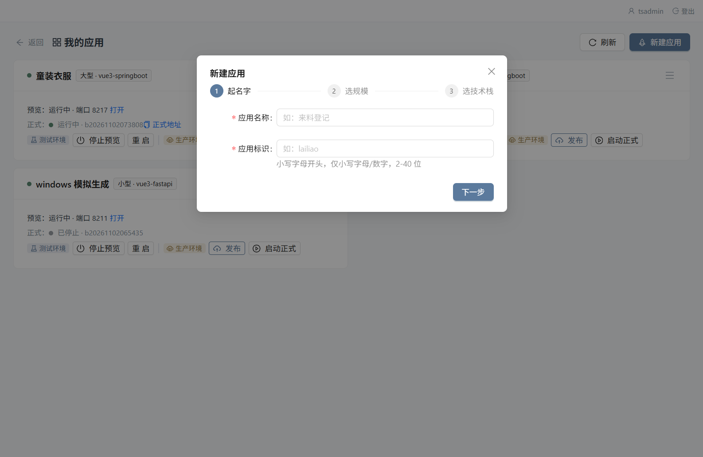

| 步 | 要填什么 | 校验与提示 |
| --- | --- | --- |
| 1 起名字 | `应用名称`（如「来料登记」）、`应用标识`（如 `lailiao`） | 标识必须小写字母开头、仅小写字母与数字、2–40 位；失焦即校验，不可用时会给你建议值 |
| 2 选规模 | `小型`：表单 / 台账 / 查询类，选一种轻量后端<br>`大型`：多角色 / 流程类系统，Vue3 + Spring Boot 3（自带登录与权限基座） | 选「大型」会直接锁定技术栈 |
| 3 选技术栈 | 小型可选 `Vue3 + FastAPI（Python）`、`Vue3 + Node（Express）`、`纯前端静态页`；大型固定 `Vue3 + Spring Boot 3` | 数据库一律自动使用 PostgreSQL，dev / prod 两套独立库 |

点「创建应用」后卡片出现，端口、工程目录、开发库都已备好。

### 应用卡片上有什么

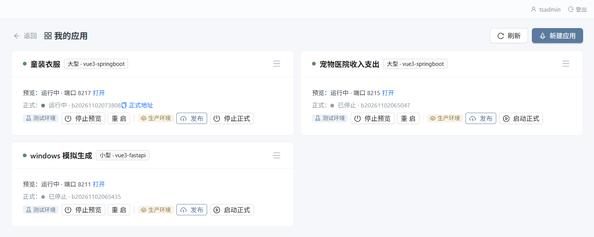

- **状态行**：`预览：运行中 · 端口 8217 打开`、`正式：运行中 · b20261102073808 正式地址`。状态词有 `运行中 / 已停止 / 启动中… / 发布中… / 出错了 / 体检未通过`。
- **测试环境**这一段：`启动预览` / `停止预览`、`重启`。
- **生产环境**这一段：`发布`、`启动正式` / `停止正式`。「该栈暂不支持发布」的提示挂在按钮上时，说明这个技术栈目前只能预览。
- **右上角 `☰` 更多操作**：

| 菜单项 | 作用 |
| --- | --- |
| 预览 | 打开右侧预览抽屉，在页面里直接操作应用 |
| 重建 dev | 重做开发库（结构或数据乱了时用） |
| 发布历史 | 打开发布记录抽屉，可查日志、回滚、删记录 |
| 资源监控 | 弹框看 CPU / 内存 / 数据库磁盘 / 工作区磁盘 |
| 发布到商店 | 把当前在服版本上架（仅已发布且未上架的应用可点） |
| 重命名 | 改应用显示名 |
| 打开工程目录 | 定位到本机上的应用工程 |
| 复制预览地址 | 拿 dev 地址发给别人 |
| 查看日志 | 打开日志抽屉 |
| DB 操作 | 新标签打开该应用的数据库管理页 |
| 删除应用 | 需要**输入应用标识**才能确认；工程目录与 `_dev` / `_prod` 库都会保留在磁盘上，不会静默抹掉 |

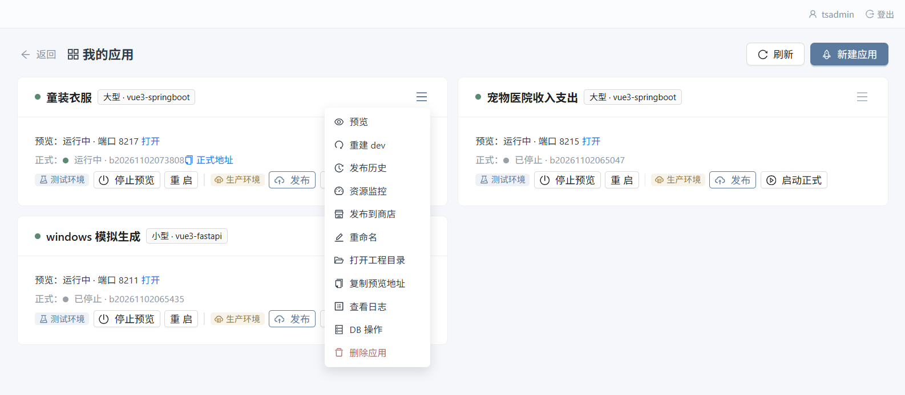

---

## 5. 用对话开发

### 5.1 输入区能做什么

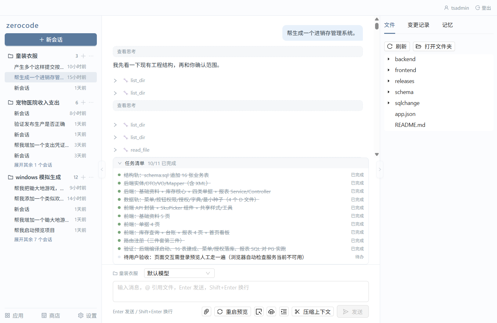

输入框提示原文：`输入消息，@ 引用文件，Enter 发送，Shift+Enter 换行`。

| 能力 | 怎么用 | 细节 |
| --- | --- | --- |
| 引用文件 | 输入 `@` 触发补全 | 按路径过滤，最多列 8 条；`↑`/`↓` 选、`Enter` 或 `Tab` 插入完整路径、`Esc` 关闭 |
| 带图提需求 | 粘贴 / 拖拽 / 点 📎 选择，三条路都通 | 最多 4 张，单张 ≤ 20MB（压缩后 ≤ 5MB），合计 ≤ 10MB；失败项可「重试」或「移除」。只有声明了「图片」能力的模型才会走视觉识别 |
| 换模型 | 输入框上方的模型下拉 | 首项是「默认模型」，其余取自「设置 → 模型库」；换模型只影响当前会话 |
| 执行中补充 | 直接再发一条消息 | 提示会变成「执行中发的消息会作为插话，在当前这步做完后生效」，按钮同步变成「插话」 |
| 中止 | 点「停止」 | 停止后当前这轮就结束，已落盘的改动不会回滚 |
| 压长对话 | 点「压缩上下文」 | 流里会出现一枚居中胶囊：`正在压缩上下文…` → `已压缩上下文：更早对话已替换为摘要；最近的对话与图片仍可查看` |

工具条上还有应用操作：`启动预览 / 重启预览`、`打开预览`、`打开生产`，以及一个 `☰`（启动/停止生产、数据库操作、重建 dev 库、发布新版本、发布记录、资源监控、预览日志）——和卡片上的动作是同一套，只是离你手头更近。

### 5.2 一轮执行长什么样

你说完需求，正常情况下会依次看到：

1. **需求澄清卡**（默认开启）。它把歧义摊成选择题，一次只问一道：

   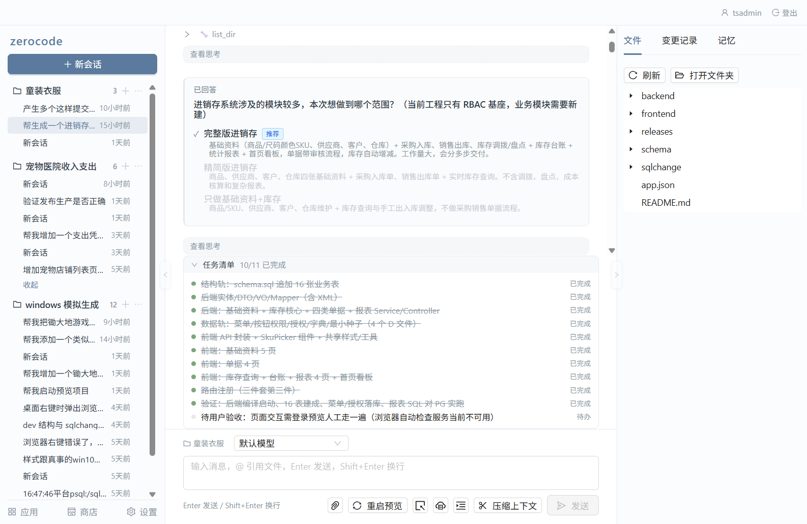

   - 选项是单选或多选，带 `推荐` 标签和一行说明；
   - 不想选就填「或人工回答」那条自由输入；
   - 三个出口：`提交回答`、`不再提问，自行决定`（让它按自己的判断开工）、`取消执行`；
   - 答过的题会留下状态词 `已回答` / `自行决定` / `已中断`，供后面回看。

   嫌它啰嗦可以在「设置 → 基础配置 → 执行参数」里关掉「需求澄清模式」，这一项按账户生效，只影响你自己。

2. **思考块**：流式时显示 `思考中…`，回看时折叠成 `查看思考`。
3. **任务清单**：`任务清单 N/M 已完成`，每一项状态是 `待办 / 进行中 / 已完成`。
4. **工具调用块**：`🔧 工具名`，展开能看到「参数」与「结果」。写文件、改文件、写库这类动作会单独弹确认卡。
5. **写入确认卡**（仅在你打开「写入前确认」时出现）：标题 `写入确认` / `修改确认` / `数据库写入确认`，按钮 `确认写入` / `拒绝`。默认这个开关是关的，改动直接落盘——想逐条把关就去设置里打开。
6. **AI 正文**：Markdown 渲染，流式时带光标。出错会是一条红色气泡 + `重试`。

---

## 6. 看它改了什么

右侧面板三个 tab。

### 变更记录

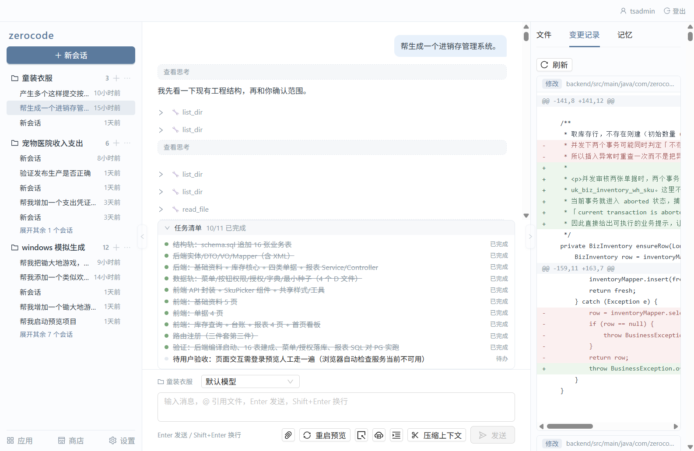

按文件逐条摊开：动作标签 `新建` / `修改` / `删除`、文件路径、然后是 diff 本体（新增行绿、删除行红、hunk 头灰）。顶部有「刷新」。空态是「暂无变更」——还没选中会话时提示「打开会话后可查看变更记录」。

### 文件

工程树 + 只读预览。`刷新`、`打开文件夹`（按设置里的「打开文件夹方式」决定是直开系统资源管理器还是走内置网页版文件管理器）、点文件后可「在编辑器中打开」。过大的文件（> 200KB）读不出来，会显示后端给的原文提示。

### 记忆

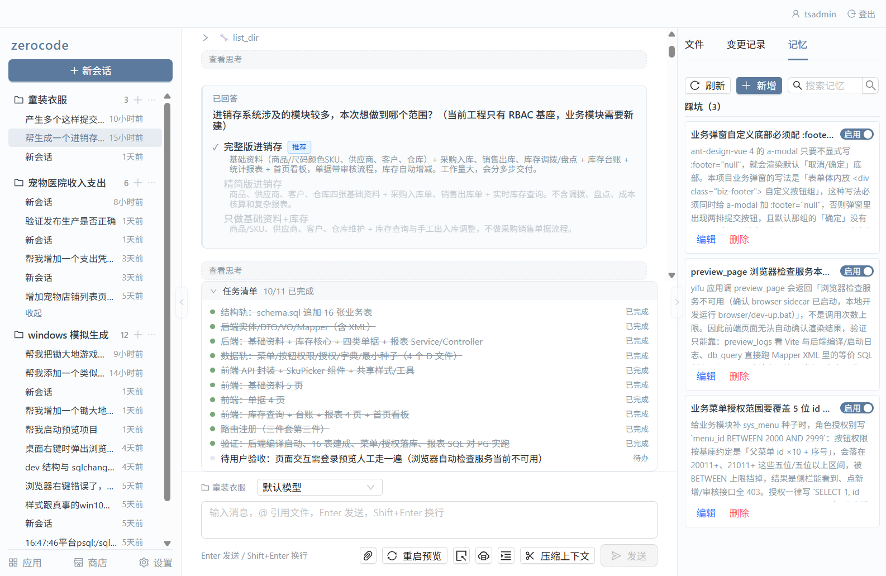

沉淀这个工作区的约定与踩过的坑，下个会话继续用。按类型分组：`偏好` / `决策` / `事实` / `踩坑` / `其他`，每组带计数。可 `搜索`、`新增`（选类型 + 可选标题 + 内容）、行内 `启用 | 停用`、`编辑`、`删除`（会确认「删除后不可恢复」）。条数多时顶部有「仅展示最近 N 条」的截断横幅。

---

## 7. 预览与调试

### 启动预览

卡片「测试环境」段点 `启动预览`，或 ☰ → `预览`。右侧抽屉里内嵌正在运行的应用：

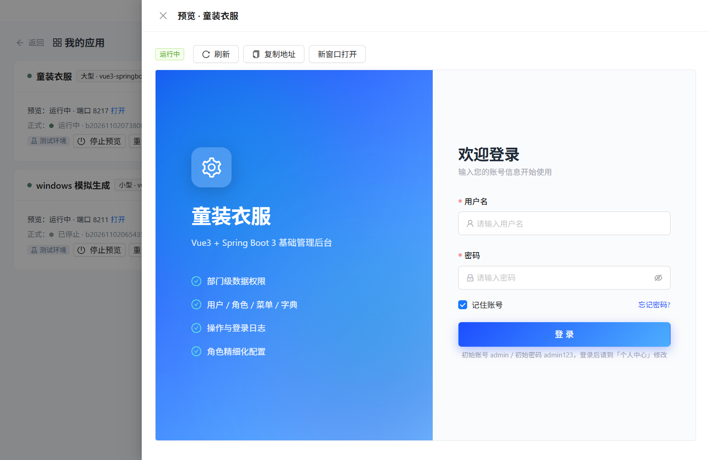

抽屉工具条：状态 tag（`运行中` 等）、`刷新`、`复制地址`、`新窗口打开`。没起来时这里会写「预览未启动——点卡片上的「启动预览」，或稍候刷新」。

**第一次启动会比较久**，因为要在容器里装依赖：FastAPI 栈约 1~3 分钟，Spring Boot 栈 5~15 分钟。别急着判断它挂了，去看日志。

大型应用（Vue3 + Spring Boot 3）自带登录基座，**初始账号 `admin` / 初始口令 `admin123`**，登进去后建议到「个人中心」改掉。

### 改完代码之后

代码或数据结构改过，点 `重启`（或输入区工具条的「重启预览」）即时生效。

数据变更走 `sqlchange` 脚本：写成带版本号的 SQL 变更文件，启动预览时按序自动执行，**只补跑没跑过的**，不会重复施加。

脚本目录分三处，决定它进哪个库：`sqlchange/` 顶层的预览库和正式库都跑；`sqlchange/dev/` 只在预览（dev）库跑，用来放示例数据；`sqlchange/prod/` 只在正式库跑。让 AI 加功能时，可以要求「示例数据只进 dev」，这样上线不会把测试用户带进正式库。

### 日志

☰ → `查看日志`（或输入区工具条里的「预览日志」）打开日志抽屉：状态 tag、`实时 | 快照` 切换、`刷新`、`复制全部`、`清空视图`、`自动滚底`，服务列表可在 `容器` 与 `平台` 之间切。它会先拉一段历史再订阅当前输出，不必回终端翻。

---

## 8. 发布上线

卡片「生产环境」段点 `发布`，弹出发布进度框：

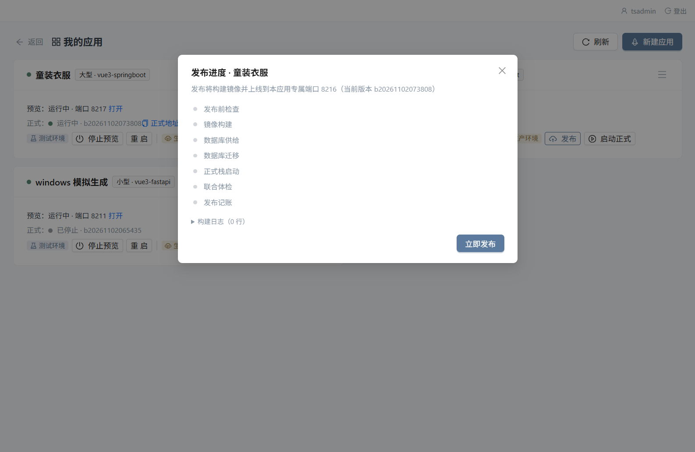

七步按顺序走，每步的状态实时可见：

| 步 | 在做什么 |
| --- | --- |
| 1 发布前检查 | 校验工程与配置，能拦住的错在动手前拦住 |
| 2 镜像构建 | 现场构建应用镜像（依赖装进镜像里） |
| 3 数据库供给 | 备齐正式库与凭据 |
| 4 数据库迁移 | 施加数据变更 |
| 5 正式栈启动 | 起 prod 容器 |
| 6 联合体检 | 探健康，确认它真的能用 |
| 7 发布记账 | 记录版本、刷新网关路由 |

底部按钮是 `立即发布`，可以折叠看「构建日志（N 行）」。如果你点发布时 AI 还在改代码，会先弹一个「AI 正在修改代码」的框问你 `继续发布` 还是 `等一等`。

**成功**：`已上线 ✓` + 访问地址 + `复制给同事`。
**失败**：显示错误原文，给 `重试发布` 和 `把错误日志发给 AI`（一键复制，粘到会话里让它排查）。构建或体检失败会**自动回退上一版本**，旧版本全程不中断。
**检测到破坏性结构变更**：发布会被阻断，要求你逐条确认「这些变更是有意为之」，可以点「生成回填骨架」，或明确「我已确认风险，继续发布」。

### 发布历史与回滚

☰ → `发布历史`：

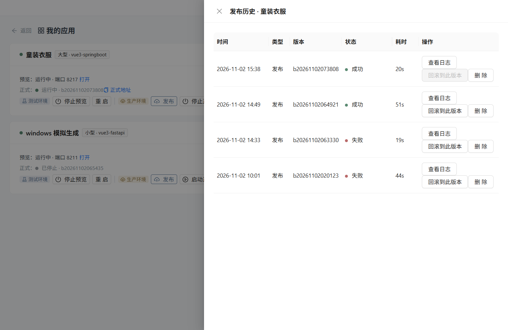

列是 `时间 / 类型 / 版本 / 状态 / 耗时 / 操作`。类型有 `发布` 与 `回滚`；状态有 `成功 / 失败 / 进行中 / 已中断`（进行中会追加当前步骤名）。操作三项：`查看日志`、`回滚到此版本`（只有历史发布版本可回滚，回滚前会再确认一次）、`删除`（清记录并尽力清理关联镜像，**数据库数据不受影响**）。

回滚只切程序版本，数据库保持当前状态。

### 资源监控

☰ → `资源监控`，弹框看四张曲线，可切 `1h / 24h / 7d / 30d`，口径是应用级汇总：

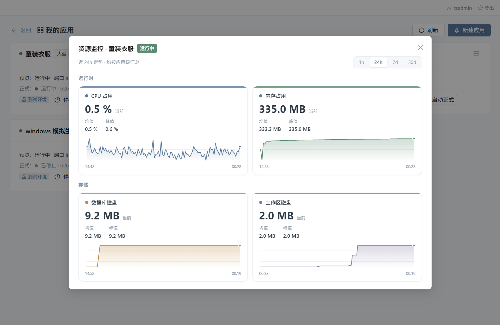

`运行时`：CPU 占用、内存占用；`存储`：数据库磁盘、工作区磁盘。每张卡都给了当前值、均值与峰值。

### 访问地址

- 只发布不配网关：`http://<服务器IP>:<prod 端口>`，同事在局域网里直接打开（防火墙要放行应用端口段，默认 8210-8399）。
- 配了中央网关与通配域名：`https://{应用标识}.<域名>` 直达。域名没备案或 443 被拦时，把 `ZEROCODE_SSL_ENABLE` 设成 `false`，地址投影会退回 IP 直连，网关不用拆。

---

## 9. 应用商店

一次开发、全团队复用：别人申请，你审批，平台给他建一份**完全独立**的实例。

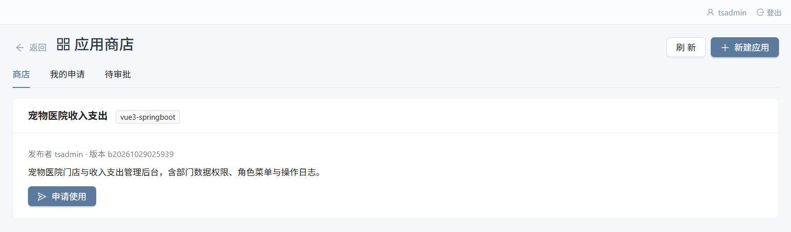

三个 tab：

| tab | 谁能看到 | 内容 |
| --- | --- | --- |
| 商店 | 所有人 | 已上架的应用卡片：名称、技术栈标签、`发布者 X · 版本 V`、简介（作者没写时显示「作者没写简介」）、`申请使用` 按钮；已经装过的显示 `已安装` 与 `打开 xxx` |
| 我的申请 | 所有人 | 自己提过的申请，列 `应用 / 我起的名字 / 状态 / 说明`；状态是后端原词（`pending` 待审批，决策后 `approved` / `rejected` / `failed`） |
| 待审批 | 仅创始人 | 每条 `我起的名字 · 来自 应用 版本`，动作 `通过并安装`，或填「驳回原因」后 `驳回` → `确认驳回`（不写原因不给驳回） |

**上架**：卡片 ☰ → `发布到商店`（前提是这个应用已经发布过，且还没上架）。弹框里填商店展示名称与一句话简介，点「上架」。上架的是当前正式在服的版本，含真实执行过的数据变更序列。

**申请到实例的过程**：申请方给实例起个名字 → 提交 → 创始人审批 → 通过后平台自动为他建一套独立代码目录与独立数据库，装完就能在商店卡片上点「打开」。数据与发布者、与其他使用者都不相通。

---

## 10. 设置

侧栏「设置」，两个 tab 加一个「技能管理」。

### 模型库

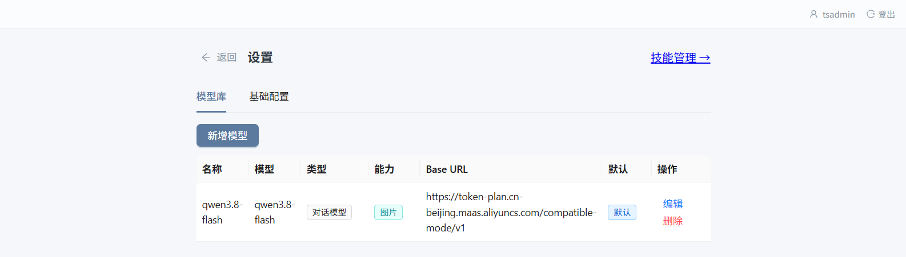

表列 `名称 / 模型 / 类型 / 能力 / Base URL / 默认 / 操作`。类型分 `对话模型` 与 `向量模型（记忆召回）`——向量模型只参与工作区记忆的语义检索，不会出现在聊天模型下拉里。能力标 `图片` 表示这个模型能看图。

`新增模型` 要填：名称、Base URL（如 `https://api.deepseek.com/v1`）、模型名（如 `deepseek-chat`）、类型、是否支持图片输入、API Key、是否设为默认。编辑时 API Key **留空表示保留原密钥**。删除会确认：引用它的会话将回退到默认模型。

### 基础配置

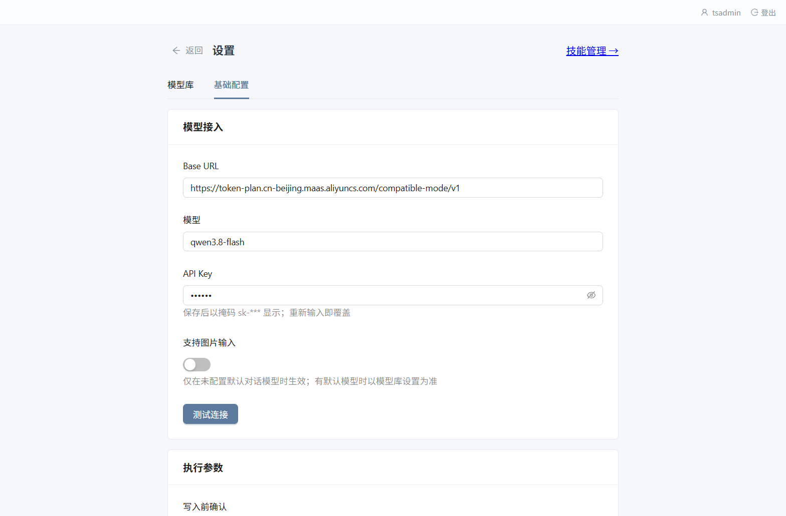

| 分组 | 字段 | 说明与默认值 |
| --- | --- | --- |
| 模型接入 | `Base URL` / `模型` / `API Key` / `支持图片输入` / `测试连接` | 这是「打底」的一套凭据。保存后密钥以掩码 `sk-***` 显示，重新输入即覆盖。配了模型库的默认对话模型后，以模型库为准 |
| 执行参数 | `写入前确认` | 默认关。打开后每次写文件 / 改文件 / 写库都要你点确认 |
| | `需求澄清模式` | 默认开。关掉只影响你自己 |
| | `提问等待超时（秒）` | 默认 `0` = 不限制 |
| | `最大工具轮数` | 默认 `30`，`0` = 不限制 |
| | `历史窗口（条数）` | 默认 `40` |
| | `打开文件夹方式` | 默认「内置文件管理器（推荐）」；另有「自动判定（本机访问直开系统资源管理器、远端访问走网页）」与「强制系统资源管理器」 |
| 环境状态 | `PostgreSQL 正常 / 异常` | 直接显示版本串或错误，是排查「功能都打不开」的第一站 |

改完记得点底部「保存」。

### 技能管理

给 AI 加本领的地方，两种来源：`从链接安装`（粘 GitHub 仓库或指向 `SKILL.md` 的直链）、`用 AI 生成`（描述你想要的技能，它出草稿，可 `重新生成`）。列表列 `名称 / 描述 / 来源 / 状态 / 操作`，可 `启用 | 停用` 与 `删除`。技能遵循 Anthropic Agent Skills 标准，安装后归属当前账户，工作区里不会出现技能文件。

---

## 11. 常见问题

| 现象 | 多半是什么原因 | 怎么办 |
| --- | --- | --- |
| 聊天直接报连接错误 | 这个账户没配模型凭据，回落链取不到就会直连官方端点然后超时 | 「设置 → 模型库」填一套 OpenAI 兼容凭据并设为默认，再「测试连接」 |
| 应用列表是空的 | 还没注册，或者注册的账号不是第一个（预置应用归创始人） | 用第一个注册的账号登录 |
| 点「启动预览」半天没反应 | 首次要在容器里装依赖 | 等；FastAPI 栈 1~3 分钟，Spring Boot 栈 5~15 分钟。开「查看日志」看进度 |
| 预览等满健康窗口报「未就绪」，但日志里前端明明 ready | 探针连的地址不对 | 核对 `.env` 的 `ZEROCODE_PREVIEW_PROBE_HOST`（部署问答第 4 步会拦错填）；别改对外端口来绕 |
| 预览地址是 `localhost`，同事打不开 | `ZEROCODE_PREVIEW_HOST` 还是打包默认值 | 改成服务器 IP 或域名；同时放行应用端口段 8210-8399 |
| 发布报超时、卡在构建那一步 | 构建期直连 PyPI / npm 等不到依赖（dev 正常不代表发布能过，两条通道） | 配 `--pypi-mirror` / `--npm-registry`（或部署问答第 4 步现场改），把同一份源注进每个应用栈 |
| 发布后新表 / 新列没出现 | 没跑 `apply-init.sh`（镜像里没有 `changelog/`，后端不会自己补 schema） | 重新执行部署脚本的第 8 步，或手工 `bash apply-init.sh` |
| 应用地址点进去全是 404 | 网关没起 / 平台与网关两侧域名不一致 / 应用 prod 没进 `routes.json` / 浏览器没信任自签 CA | 按这四项逐个核对，见包内 `README-deploy.md` 排障表 |
| 域名打不开（未备案、443 被重置） | 中间设备拦了 TLS | 把 `ZEROCODE_SSL_ENABLE` 设 `false` 走 IP 直连，网关不用拆；备案后改回 `true` |
| 对话太长、越答越慢 | 上下文窗口吃紧 | 点输入区的「压缩上下文」，更早的对话会被换成摘要，最近的对话与图片仍在 |
| 图片传不上去 | 超过 4 张、单张 > 20MB、或合计 > 10MB | 减少张数或压一下；失败项上有「重试」「移除」 |
| 模型不看图 | 当前模型没声明视觉能力 | 「设置 → 模型库」里把该模型的「支持图片输入」打开，或换模型 |
| 端口被占用，栈起不来 | 别的容器或宿主进程占了 | 重跑 `deploy.sh`，第 5 步会点名占用者：容器问你要不要 stop，宿主进程只报 PID 让你自己确认 |
| 想彻底推倒重来 | —— | 部署时选「新增」，检测到已有 `pgdata` 卷会要求逐字输入 `yes` 才删；升级模式永不删卷 |
| 只改 `.env` 里的口令没生效 | 卷里存的还是旧口令 | 口令变更必须走「新增」重建库，或手工改卷 |

---

## 12. 端口与目录约定

| 端口 | 用途 |
| --- | --- |
| `8100` | 平台控制台（后端，同时托管前端构建产物） |
| `8082` | 平台前端 Vite 开发服务（只在开发模式出现） |
| `5433` | 平台数据库 PostgreSQL 的宿主端口 |
| `8210-8399` | 各应用 dev / prod 端口，由平台自动分配并落库为 UNIQUE 约束兜底 |
| `80 / 443` | 中央 OpenResty 网关（起网关才占） |
| `8101` | 浏览器 sidecar（只对 compose 网络内开放，不发布到宿主） |

部署根（默认 `/opt/zerocode`）下的目录：

```
docker-compose.yml   平台栈定义
init.sql             全量 schema + 种子（每次发布重放，只补不覆盖）
apply-init.sh        重放 init.sql 的入口
deploy.sh            部署内核（纯交互）
deploy_lib.sh        被内核 source 的判定层
deploy.ps1/.bat      Windows 侧的 WSL2 皮
apps/                每个应用的工程目录（现场产物，升级不覆盖）
data/                运行期落盘数据
store/               商店包
gateway/             中央网关：certs/ 与 routes/ 都是现场产物，不在包里
.env                 部署现场填的运行参数（口令只进这里）
.deploy-answers      上次答过的非敏感项，下次当默认值
```

`apps/`、`data/`、`store/`、`gateway/certs/`、`gateway/routes/`、`gateway/.env`、`.env`、`.deploy-answers` 这八项加 `pgdata` 卷属于**现场产物**：任何同步命令都不许带 `--delete` 去碰它们，一条 `rsync -a --delete` 就能把口令、证书、路由表和服务器上新建的应用一起扫掉。这也是为什么升级走 `deploy.sh` 而不是手工同步。
